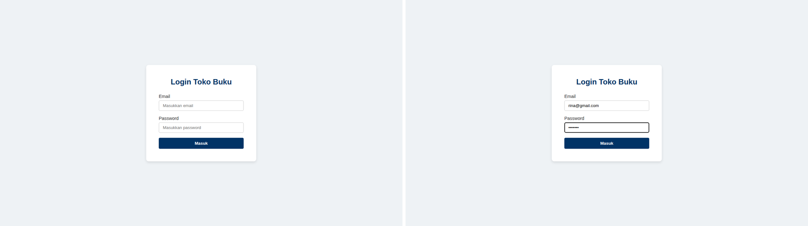
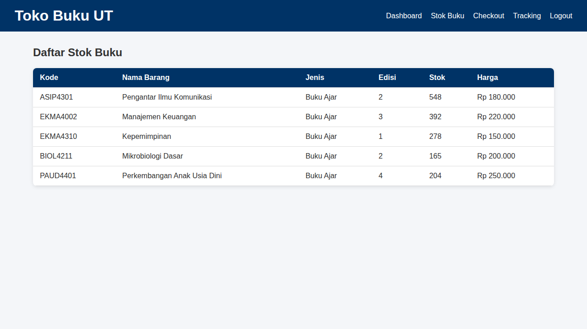
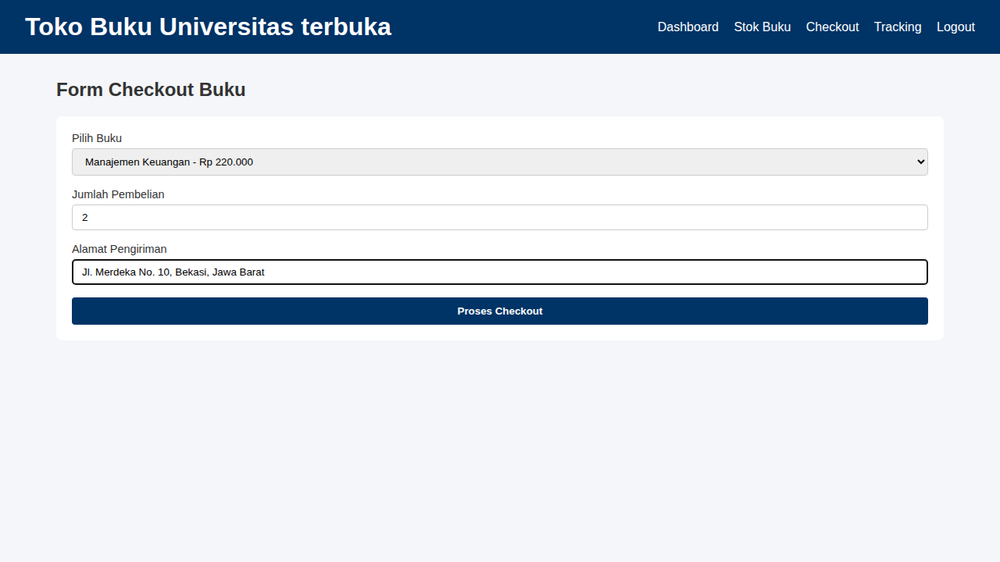
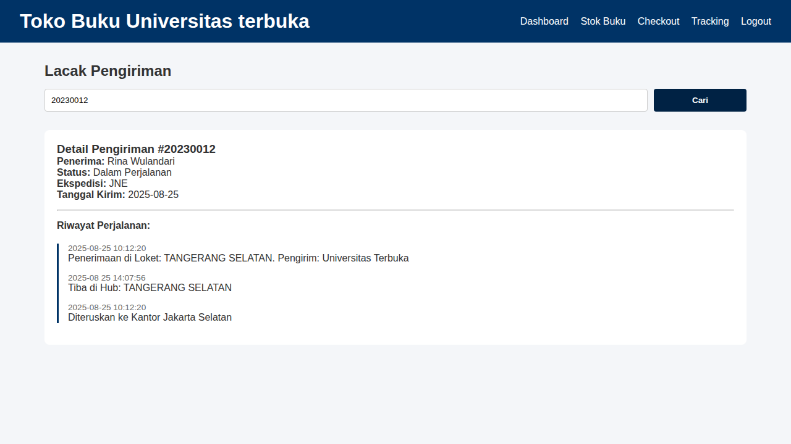

# Toko Buku UT

Aplikasi web sederhana untuk toko buku Universitas Terbuka (UT), dibuat sebagai **Tugas UTS Pemrograman Web**. Aplikasi berjalan sepenuhnya di sisi klien (frontend) memakai HTML, CSS, dan JavaScript murni tanpa framework maupun backend. Seluruh data disimpan dalam file JavaScript (`js/data.js`).

## Fitur

| Halaman | File | Deskripsi |
| --- | --- | --- |
| Login | `index.html` | Autentikasi berdasarkan email dan password. Data user disimpan di `localStorage` setelah berhasil login. |
| Dashboard | `dashboard.html` | Menampilkan katalog buku dalam bentuk kartu (cover, judul, kode, edisi, harga). |
| Stok Buku | `stok.html` | Tabel daftar stok: kode, nama barang, jenis, edisi, stok, dan harga. |
| Checkout | `checkout.html` | Form pemesanan: pilih buku, jumlah pembelian, dan alamat pengiriman. |
| Tracking | `tracking.html` | Pencarian status pengiriman berdasarkan Nomor DO, lengkap dengan riwayat perjalanan (timeline). |
| Logout | semua halaman (menu) | Menghapus sesi dari `localStorage` lalu kembali ke halaman login. |

## Tangkapan Layar

Berikut tampilan setiap proses dalam aplikasi, sesuai alur penggunaan.

### 1. Login

Pengguna mengisi akun demo (contoh: `rina@gmail.com` / `rina123`), lalu menekan tombol login. Jika berhasil, muncul pesan sambutan dan pengguna diarahkan ke Dashboard.



### 2. Dashboard (Katalog Buku)

Menampilkan seluruh buku dalam bentuk kartu beserta cover, kode, edisi, dan harga.


### 3. Stok Buku

Tabel daftar stok berisi kode, nama barang, jenis, edisi, stok, dan harga.



### 4. Checkout

Form pemesanan: memilih buku, mengisi jumlah, dan alamat pengiriman. Setelah dikirim, muncul notifikasi bahwa pesanan berhasil diproses.



### 5. Tracking Pengiriman

Hasil pencarian Nomor DO `20230012` berisi detail pengiriman dan riwayat perjalanan.



Jika Nomor DO tidak terdaftar, ditampilkan pesan "Nomor DO tidak ditemukan!".

### 6. Logout

Menu Logout menghapus sesi dan mengembalikan pengguna ke halaman login.

## Teknologi

- HTML5
- CSS3 (Flexbox, CSS Grid, media query responsif)
- JavaScript (Vanilla JS, DOM manipulation, template literal, `localStorage`)

## Struktur Folder

```
tugas-uts-web1/
├── index.html          # Halaman login
├── dashboard.html      # Katalog buku
├── stok.html           # Daftar stok buku
├── checkout.html       # Form checkout
├── tracking.html       # Lacak pengiriman
├── css/
│   └── style.css       # Seluruh styling aplikasi
├── js/
│   ├── data.js         # Data pengguna, katalog buku, dan tracking
│   └── script.js       # Logika aplikasi (login, render, checkout, tracking, logout)
├── screenshots/        # Tangkapan layar untuk README
└── img/                # Cover buku
    ├── pengantar_komunikasi.jpg
    ├── manajemen_keuangan.jpg
    ├── kepemimpinan.jpg
    ├── mikrobiologi.jpg
    └── paud_perkembangan.jpg
```

## Cara Menjalankan

1. Ekstrak file ZIP project.
2. Buka folder `tugas-uts-web1`.
3. Buka `index.html` di browser (klik dua kali, atau gunakan ekstensi *Live Server* di VS Code).
4. Login memakai salah satu akun demo di bawah.

Tidak perlu instalasi atau server tambahan.

## Akun Demo

| Nama | Email | Password | Role |
| --- | --- | --- | --- |
| Rina Wulandari | rina@gmail.com | rina123 | User |
| Agus Pranoto | agus@gmail.com | agus123 | User |
| Siti Marlina | siti@gmail.com | siti123 | Admin |

## Data Contoh

**Katalog buku**

| Kode | Nama Buku | Edisi | Stok | Harga |
| --- | --- | --- | --- | --- |
| ASIP4301 | Pengantar Ilmu Komunikasi | 2 | 548 | Rp 180.000 |
| EKMA4002 | Manajemen Keuangan | 3 | 392 | Rp 220.000 |
| EKMA4310 | Kepemimpinan | 1 | 278 | Rp 150.000 |
| BIOL4211 | Mikrobiologi Dasar | 2 | 165 | Rp 200.000 |
| PAUD4401 | Perkembangan Anak Usia Dini | 4 | 204 | Rp 250.000 |

**Nomor DO untuk uji tracking**

| Nomor DO | Penerima | Ekspedisi | Status |
| --- | --- | --- | --- |
| 20230012 | Rina Wulandari | JNE | Dalam Perjalanan |
| 20230013 | Agus Pranoto | Pos Indonesia | Dikirim |

## Alur Penggunaan

1. Login di `index.html` dengan akun demo.
2. Lihat katalog buku di **Dashboard**.
3. Cek ketersediaan di **Stok Buku**.
4. Lakukan pemesanan di **Checkout**.
5. Lacak pengiriman di **Tracking** dengan memasukkan Nomor DO (contoh: `20230012`).
6. Klik **Logout** untuk keluar.

## Catatan dan Keterbatasan

Project ini ditujukan untuk pembelajaran, sehingga beberapa hal masih disederhanakan:

- Data bersifat statis (hardcoded di `data.js`), tidak terhubung ke database atau API.
- Password disimpan sebagai teks biasa dan validasi login dilakukan di sisi klien, sehingga **tidak aman untuk penggunaan produksi**.
- Halaman selain login belum memiliki proteksi akses; halaman dapat dibuka langsung tanpa login.
- Proses checkout hanya menampilkan notifikasi berhasil, belum menyimpan pesanan maupun mengurangi stok.
- Fungsi sapaan dinamis (`greetingText`) sudah ada di `script.js`, tetapi elemennya belum dipasang di halaman HTML manapun.
- Pada data tracking DO `20230012`, terdapat salah ketik format tanggal (`2025-08 25`) dan urutan waktu yang belum konsisten.

## Pengembangan Selanjutnya

- Menambahkan proteksi halaman (redirect ke login jika belum masuk).
- Menyimpan riwayat pesanan dan mengurangi stok saat checkout.
- Fitur khusus Admin (kelola stok dan data buku).
- Integrasi backend dan database.

## Pembuat

| | |
| --- | --- |
| **Nama** | Muhammad Zaki Ramadhan |
| **NIM** | 312510100 |
| **Tugas** | UTS Pemrograman Web |
